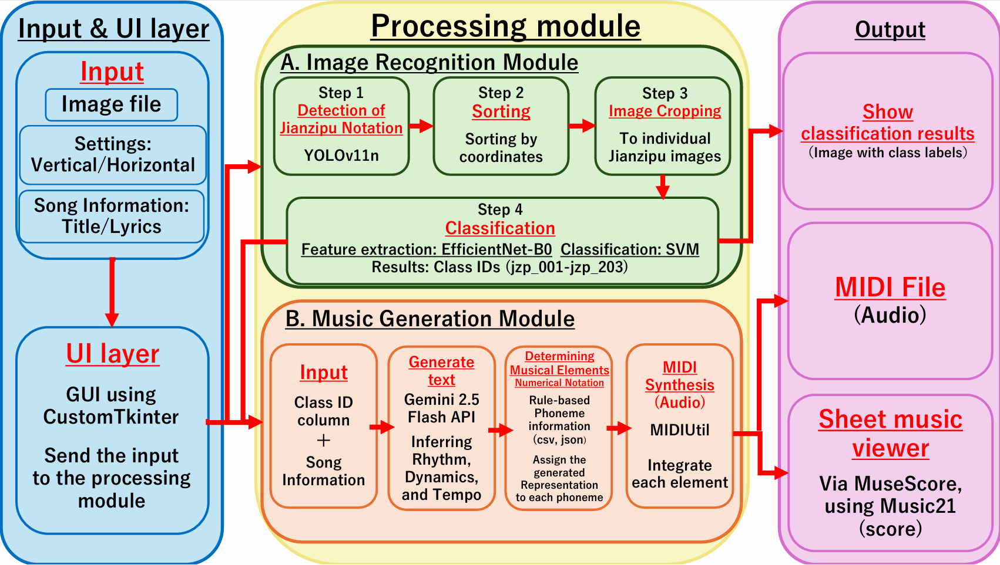
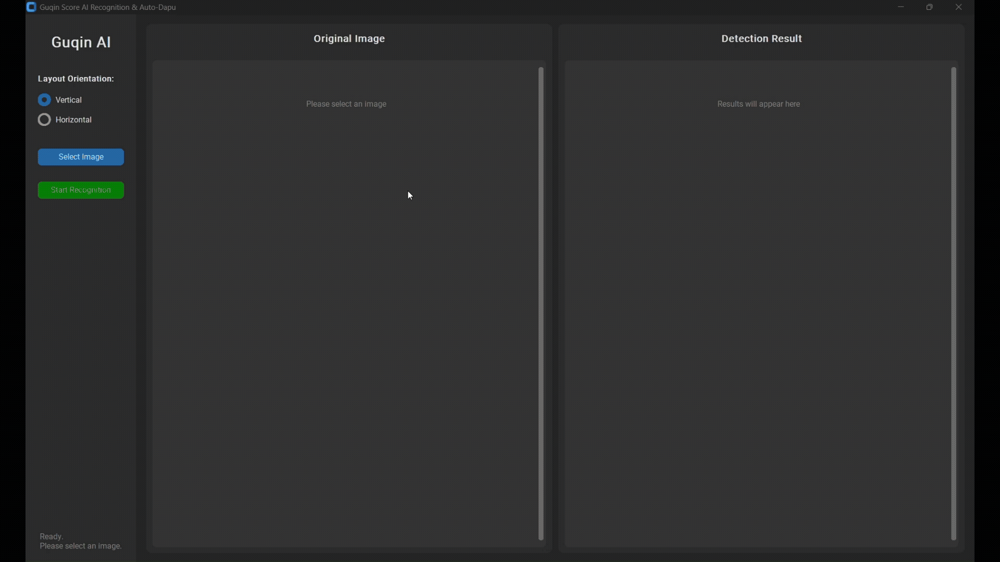
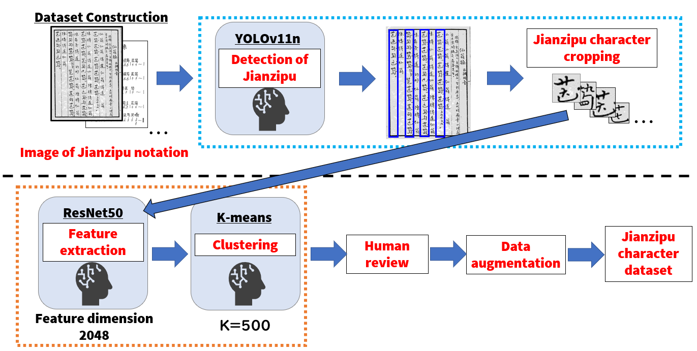

# Guqin Jianzipu Recognition & Auto-Dapu System — 琴音 (Qin-Yin)

**English** | [日本語](README_ja.md) | [简体中文](README_zh-CN.md)


An end-to-end AI system for recognizing traditional Chinese Guqin notation
(**Jianzipu / 減字譜**) and generating playable musical output through
**Computer Vision, Machine Learning, and Large Language Models**.

The system detects and recognizes Jianzipu characters from score images,
reconstructs pitch-related musical information, supplements missing expressive
elements with an LLM, and generates **MIDI and standard musical notation**.

This project is based on a series of peer-reviewed research studies.
The dataset construction and data augmentation methodology was presented at
**ICMIP 2026** and published in the **SPIE Digital Library** as
[**"Research on Restoring Guqin Music through Deep Learning"**](https://www.spiedigitallibrary.org/conference-proceedings-of-spie/14298/3119406/Research-on-restoring-Guqin-music-through-deep-learning/10.1117/12.3119406.full).
The subsequent work, extending the research into the integrated end-to-end
recognition and Auto-Dapu system implemented in this repository, has been
accepted for presentation at [**IPMV 2027**](https://ipmv.org/) in Tokyo, Japan.

---

## Overview



The **Guqin (古琴)** is a traditional Chinese musical instrument with a history
spanning thousands of years.

Its traditional notation system, **Jianzipu (減字譜)**, encodes information such
as fingerings, string numbers, and playing techniques by combining
character-like components into compact symbols.

However, Jianzipu generally does **not explicitly describe musical elements such
as rhythm, tempo, or dynamics**.

Traditionally, reconstructing a playable interpretation from a Jianzipu score
requires a specialized process called **Dapu (打譜)**, in which musicians
interpret the notation together with the historical and musical context of the
piece.

This project explores an AI-assisted approach to that process by integrating:

- **Object Detection** for locating Jianzipu characters
- **Deep Learning + SVM** for character recognition
- **Rule-based music mapping** for pitch reconstruction
- **Large Language Models** for musical-expression generation
- **MIDI / MuseScore integration** for playable output

### Processing Pipeline

```text
  Jianzipu Score Image
           │
           ▼
┌──────────────────────┐
│  Character Detection │
│       YOLO11n        │
└──────────┬───────────┘
           │
           ▼
┌──────────────────────┐
│  Reading-order Sort  │
│  Vertical/Horizontal │
└──────────┬───────────┘
           │
           ▼
┌───────────────────────┐
│ Character Recognition │
│  EfficientNet-B0+SVM  │
└──────────┬────────────┘
           │
           ▼
┌──────────────────────┐
│  Musical Information │
│   Pitch / Technique  │
└──────────┬───────────┘
           │
           ▼
┌───────────────────────┐
│     AI Auto-Dapu      │
│   Gemini 2.5 Flash    │
│   Rhythm / Dynamics   │
└──────────┬────────────┘
           │
           ▼
      MIDI / Score
```

---

## Key Results

The following results were obtained in the undergraduate research project on
which this repository is based.

| Task | Method | Result |
|---|---|---:|
| Jianzipu character detection | YOLO11n | **mAP50: 99.17%** |
| Jianzipu character detection | YOLO11n | **mAP50-95: 80.43%** |
| Jianzipu character recognition | EfficientNet-B0 + SVM | **Accuracy: 99.37%** |
| Jianzipu character recognition | EfficientNet-B0 + SVM | **Macro F1: 0.994** |
| Recognition dataset | Jianzipu characters | **203 classes** |
| Augmented dataset | Jianzipu images | **40,600 images** |

> These metrics correspond to the experimental setting used in the
> undergraduate thesis.

---

## Demo



The desktop GUI performs the recognition pipeline from an input score image and
visualizes the detected Jianzipu characters in reading order.

After recognition, the user can provide the piece title and optional contextual
information such as lyrics or scene descriptions. The system then generates
musical-expression parameters and exports the result as MIDI.

---

## Features

### Jianzipu Character Detection

**YOLO11n** is used to detect individual Jianzipu symbols from an input score
image.

The detector was selected by comparing multiple YOLO architectures while
considering both detection accuracy and computational efficiency.

### Vertical and Horizontal Score Support

The system supports both reading layouts:

- **Vertical notation:** top-to-bottom, right-to-left
- **Horizontal notation:** left-to-right, top-to-bottom

Bounding boxes detected by YOLO are automatically reordered from their
coordinates before classification.

### EfficientNet-B0 + SVM Recognition

Individual Jianzipu character images are recognized using a hybrid
classification architecture:

```text
Character Image
      │
      ▼
EfficientNet-B0
Feature Extractor
      │
      ▼
Feature Vector
      │
      ▼
     SVM
      │
      ▼
Jianzipu Class
```

EfficientNet-B0 is used for visual feature extraction, and an SVM performs the
final multi-class classification.

The current recognition model handles **203 Jianzipu classes**.

### Semi-Automated Dataset Construction

Creating a Jianzipu dataset manually is labor-intensive because of the large
number of symbols and the visual similarity between many character structures.



The research dataset was constructed using the following semi-automated
workflow:

1. Detect Jianzipu characters from score images using YOLO
2. Crop individual character regions
3. Extract visual features using ResNet50
4. Group visually similar samples with k-means clustering
5. Manually verify and assign class labels
6. Apply data augmentation using Albumentations

This process resulted in:

- **203 Jianzipu classes**
- **1,533 collected original character images**
- **40,600 images after data augmentation**

### Musical Information Reconstruction

Each recognized Jianzipu class is associated with musical information stored in
`data/data.csv`.

The mapping includes information such as:

- String number
- Hui position
- Playing technique
- Sound type
- Pitch information

The system combines these attributes with `data/tuning_map.json` to reconstruct
the pitch corresponding to each recognized Jianzipu symbol.

### LLM-Based Auto-Dapu

Jianzipu does not explicitly contain all musical information required for
performance.

To explore automatic supplementation of these missing elements, the system uses
**Gemini 2.5 Flash**.

The LLM receives:

- Piece title
- Optional lyrics or scene description
- Recognized Jianzipu sequence

It generates parameters such as:

- Tempo
- Note duration
- Velocity
- Overall musical atmosphere

The generated expressive parameters are combined with the pitch information
obtained from the recognition pipeline.

> The LLM output represents an AI-generated interpretation. It is not intended
> to be a historically authoritative reconstruction of Guqin performance.

### MIDI and Musical Score Output

The final note sequence is exported as a standard **MIDI file**.

The application can also integrate with **MuseScore** through `music21`, allowing
the generated MIDI sequence to be displayed as standard musical notation.

---

## Technology Stack

| Category | Technology |
|---|---|
| Programming Language | Python |
| Deep Learning | PyTorch, torchvision |
| Object Detection | Ultralytics YOLO11 |
| CNN | EfficientNet-B0 |
| Classical ML | scikit-learn / SVM |
| Image Processing | OpenCV, Pillow |
| GUI | CustomTkinter |
| LLM | Google Gemini 2.5 Flash |
| MIDI Generation | MIDIUtil |
| Music Processing | music21 |
| Score Visualization | MuseScore |

---

## Project Structure

```text
guqin-auto-dapu/
├── .gitignore
├── README.md
├── README_ja.md
├── README_zh-CN.md
├── requirements.txt
├── setup.py
├── LICENSE
├── main.py
├── detector.py
├── classifier.py
├── output_ai.py
├── utils.py
│
├── assets/
│   ├── system_architecture.png
│   ├── dataset_creation.png
│   └── demo.gif
│
├── data/
│   ├── data.csv
│   └── tuning_map.json
│
└── models/
    ├── yolo11_model.pt
    ├── efficientnet_b0_model.pth
    └── efficientnet_b0_svm_model.pkl
```

Recognition results and generated MIDI files are written to `output_images/` at
runtime. The directory is created automatically and is excluded from Git by
`.gitignore`.

---

## Getting Started

### 1. Requirements

The application was developed with Python 3.10.

Python **3.10 or later** is recommended. Using a virtual environment such as
`venv` or Anaconda is strongly recommended.

### 2. Clone the Repository

```bash
git clone https://github.com/atsu-4444/guqin-auto-dapu.git
cd guqin-auto-dapu
```

### 3. Install Dependencies

```bash
pip install -r requirements.txt
```

The bundled trained model files are expected under `models/`.

> For security, use only model files from a trusted source. Python model formats
> such as `.pkl` and some `.pt` checkpoints may deserialize Python objects when
> loaded.

### 4. Configure MuseScore

MuseScore is used to display generated MIDI files as standard musical notation.

Install **MuseScore 4**, then run:

```bash
python setup.py
```

The current setup script uses this default Windows path:

```text
C:/Program Files/MuseScore 4/bin/MuseScore4.exe
```

If MuseScore is installed elsewhere, change `musescore_path` in `setup.py`.

> MIDI generation itself does not require MuseScore. MuseScore is used only for
> score visualization.

### 5. Configure the Gemini API

Gemini is used during the AI Auto-Dapu stage.

Set your API key as the `GOOGLE_API_KEY` environment variable.

#### Windows Command Prompt

```cmd
set GOOGLE_API_KEY=your_api_key_here
```

#### Windows PowerShell

```powershell
$env:GOOGLE_API_KEY="your_api_key_here"
```

#### macOS / Linux

```bash
export GOOGLE_API_KEY="your_api_key_here"
```

Do **not** hard-code or commit API keys to the repository.

### 6. Launch the Application

```bash
python main.py
```

The trained models are loaded asynchronously when the application starts.

---

## Usage

1. Launch the application with `python main.py`.
2. Select the score orientation: **Vertical** or **Horizontal**.
3. Select a Jianzipu score image that you own or are authorized to use.
4. Click **Start Recognition**.
5. YOLO detects individual symbols and reconstructs their reading order.
6. EfficientNet-B0 + SVM classifies each detected character.
7. Review the recognition result in the GUI.
8. Choose whether to generate music from the recognized sequence.
9. Enter the piece title and optional contextual information.
10. Generate and save the MIDI file.
11. Optionally display the result with MuseScore.

---

## Dataset and Third-Party Materials

The research dataset was constructed primarily from Jianzipu materials related
to:

- **Xian-Weng-Cao (仙翁操)**
- **Chun-Xiao-Yin (春暁吟)**

During the research, score images were collected from publicly accessible
third-party web materials and processed into individual Jianzipu character
samples.

The **original source score images and the complete research training dataset are
not distributed in this repository**.

Users who want to run the application should provide their own Jianzipu score
image, or an image they have permission to use.

The figures and GUI demonstrations under `assets/` are included to explain the
research workflow and software behavior. They are not intended to distribute the
original research dataset.

Copyright and other rights to third-party source materials remain with their
respective rights holders.

---

## Security and Privacy Notes

- The Gemini API key is read from the `GOOGLE_API_KEY` environment variable and
  is not hard-coded in the source code.
- In the current implementation, the selected score image itself is processed
  locally and is **not sent to Gemini**.
- If AI Auto-Dapu is used, the **piece title, optional textual context, and
  recognized Jianzipu IDs** are sent to the Gemini API.
- Do not replace the bundled `.pkl`, `.pt`, or `.pth` model files with files from
  untrusted sources.
- Generated recognition images and MIDI files are stored locally under
  `output_images/`.

---

## Research Context

This repository is based on the undergraduate thesis:

> **深層学習を用いた古琴譜の識別および自動打譜システムの構築**  
> *Recognition of Guqin Jianzipu Using Deep Learning and Development of an
> Automatic Dapu System*

The research focused on three main challenges:

1. Expanding Jianzipu recognition beyond a small number of character classes
2. Building a high-accuracy recognition pipeline using CNN-based feature
   extraction and SVM classification
3. Supplementing musical information absent from Jianzipu through contextual
   reasoning with a Large Language Model

The resulting application integrates the complete workflow into a single
desktop system.

---

## My Contributions

This project was conducted as a collaborative undergraduate research project.

### Atsushi Ito — Lead Developer / Primary Technical Contributor

I led the technical work end-to-end and was primarily responsible for the
design, implementation, experimentation, and integration of the system.

My main contributions included:

- Designing the overall system architecture
- Implementing the Jianzipu detection pipeline using YOLO
- Implementing coordinate-based reading-order reconstruction for vertical and
  horizontal notation
- Developing and evaluating the Jianzipu recognition pipeline
- Integrating EfficientNet-B0 feature extraction with SVM classification
- Building the character-to-musical-information mapping pipeline
- Designing and implementing the Gemini-based Auto-Dapu approach
- Implementing MIDI generation and MuseScore integration
- Developing the desktop GUI using CustomTkinter
- Integrating the AI and music-processing components into a single end-to-end
  application
- Conducting the main model experiments and technical evaluation
- Preparing and maintaining the software implementation for this repository

### Research Collaborators

**Kazuma Amano** and **Keitaro Ishii**

The research collaborators mainly supported:

- Collection of Jianzipu source materials
- Dataset checking and manual verification
- Review and confirmation during the research process

---

## Limitations

This project is a research prototype.

- The current classifier recognizes **203 Jianzipu classes** and does not cover
  the entire Jianzipu vocabulary.
- The dataset mainly contains material from a limited number of Guqin pieces.
- Recognition performance may decrease for different manuscripts, handwriting
  styles, printing styles, degraded documents, or unseen symbols.
- LLM-generated Auto-Dapu output is one possible AI-generated interpretation
  and should not be treated as a historically verified performance.
- MuseScore configuration currently assumes a typical Windows installation path
  unless `setup.py` is edited.

---

## Future Work

Potential future improvements include:

- Expanding the dataset to additional pieces and manuscripts
- Improving robustness to handwriting and historical document degradation
- Supporting unseen or previously unregistered Jianzipu structures
- Exploring component-level recognition of Jianzipu radicals
- Improving confidence estimation and recognition-error handling
- Evaluating generated musical expressions with Guqin experts
- Comparing LLM-generated Dapu with historical or expert interpretations
- Improving cross-platform MuseScore integration

---

## Authors

### Atsushi Ito
Lead Developer / Primary Technical Contributor  
Nippon Institute of Technology  
Artificial Intelligence Laboratory

### Research Collaborators
- Kazuma Amano
- Keitaro Ishii

---

## License

This project is released under the **GNU Affero General Public License v3.0
(AGPL-3.0)**.

See [LICENSE](LICENSE) for details.

This project uses Ultralytics YOLO, which is distributed under the AGPL-3.0
license for open-source use.

Third-party Jianzipu score images and other externally sourced materials are
not covered by this license and remain subject to the rights of their
respective rights holders.
