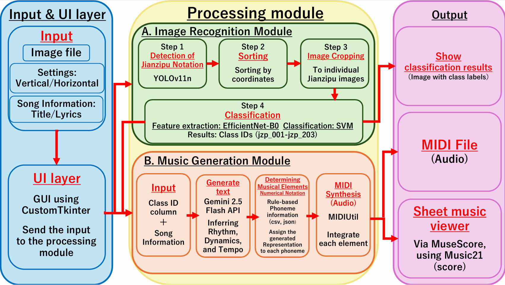
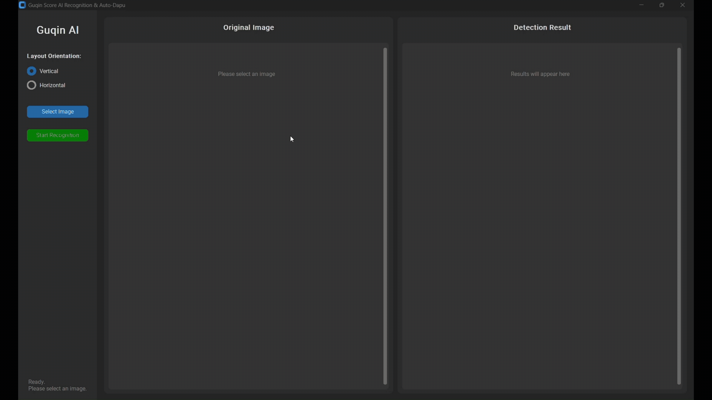
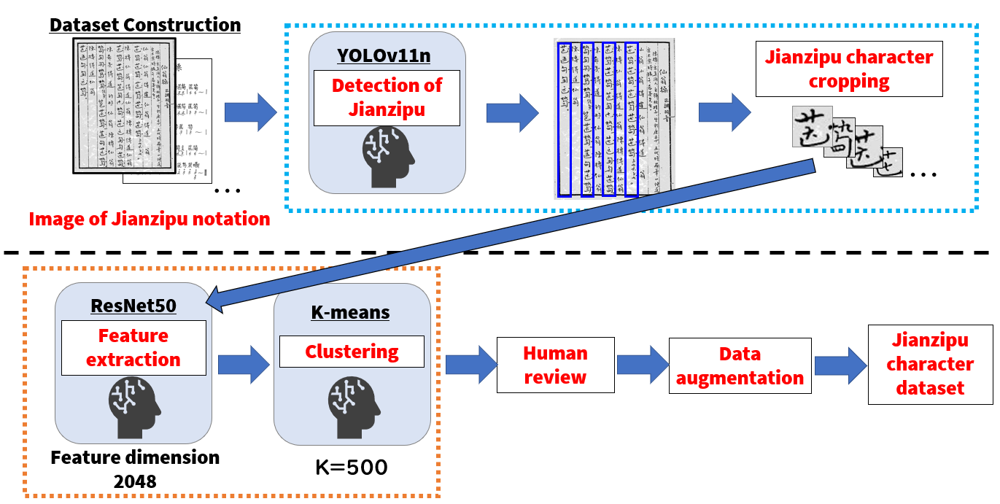

# 古琴減字譜認識・自動打譜システム — 琴音 (Qin-Yin)

[English](README.md) | **日本語** | [简体中文](README_zh-CN.md)


中国の伝統楽器・古琴で用いられる楽譜である
**減字譜（Jianzipu）** を認識し、演奏可能な音楽データを生成する
End-to-End AIシステムです。

本システムは、楽譜画像から減字譜単字を検出・識別し、
音高に関する音楽情報を復元したうえで、楽譜に明記されていない演奏表現を
LLMによって補完し、**MIDIおよび五線譜**として出力します。

本プロジェクトは、一連の査読付き研究成果を基にしています。
データセット構築およびデータ拡張手法については、
**ICMIP 2026** で発表し、**SPIE Digital Library** に
[**"Research on Restoring Guqin Music through Deep Learning"**](https://www.spiedigitallibrary.org/conference-proceedings-of-spie/14298/3119406/Research-on-restoring-Guqin-music-through-deep-learning/10.1117/12.3119406.full)
として公開されています。

さらに、その研究を発展させ、本リポジトリで実装している
減字譜認識から自動打譜までを統合したEnd-to-Endシステムに関する研究が、
東京で開催される [**IPMV 2027**](https://ipmv.org/) に採択され、
発表予定です。

---

## 概要



**古琴（Guqin / 古琴）** は数千年の歴史を持つ中国の伝統楽器です。

古琴で用いられる **減字譜** は、指使い、弦番号、奏法などの情報を、
漢字の部首のような要素を組み合わせた一つの記号として表現します。

一方で、減字譜には一般に **リズム、テンポ、強弱などの音楽的要素が明示されません**。

そのため、実際に演奏可能な形へ復元するには、楽曲の背景や文脈を解釈しながら
演奏表現を補う **打譜（Dapu）** と呼ばれる専門的な作業が必要です。

本プロジェクトでは、この打譜をAIで支援するために、以下を統合しています。

- **物体検出**による減字譜単字の検出
- **Deep Learning + SVM** による文字識別
- **ルールベースの音楽情報マッピング**による音高復元
- **LLM** による演奏表現生成
- **MIDI / MuseScore** による出力

### 処理フロー

```text
     減字譜画像
         │
         ▼

  減字譜単字の検出   
      YOLO11n      
         │
         ▼

    読み順の整列 
   縦書き / 横書き
         │
         ▼

    減字譜の識別
  EfficientNet+SVM

         │
         ▼

    音楽情報復元
   音高 / 奏法等
         │
         ▼

    AI 自動打譜
  Gemini 2.5 Flash
   リズム / 強弱等
         │
         ▼
    MIDI / 五線譜
```

---

## 主な研究成果

本リポジトリの基となった卒業研究では、以下の結果を得ました。

| タスク | 手法 | 結果 |
|---|---|---:|
| 減字譜単字検出 | YOLO11n | **mAP50: 99.17%** |
| 減字譜単字検出 | YOLO11n | **mAP50-95: 80.43%** |
| 減字譜単字識別 | EfficientNet-B0 + SVM | **Accuracy: 99.37%** |
| 減字譜単字識別 | EfficientNet-B0 + SVM | **Macro F1: 0.994** |
| 識別対象 | 減字譜単字 | **203クラス** |
| 拡張後データセット | 減字譜画像 | **40,600枚** |

> 上記の評価値は、卒業論文で用いた実験条件に基づく結果です。

---

## デモ



GUIから減字譜画像を入力すると、単字検出・読み順整列・文字識別までを実行し、
結果を画像上に可視化します。

識別後は、楽曲名や任意の歌詞・情景情報を入力し、AIによる演奏表現生成を行って
MIDIとして保存できます。

---

## 主な機能

### 減字譜単字検出

入力された楽譜画像から **YOLO11n** を用いて個々の減字譜単字を検出します。

複数のYOLOアーキテクチャを比較し、検出精度と計算効率の両面を考慮して
YOLO11nを採用しました。

### 縦書き・横書きへの対応

- **縦書き:** 上から下、右から左
- **横書き:** 左から右、上から下

YOLOが出力したBounding Boxの座標に基づき、識別前に演奏順へ自動整列します。

### EfficientNet-B0 + SVM による識別

```text
減字譜単字画像
      │
      ▼
EfficientNet-B0
  特徴抽出器
      │
      ▼
 特徴ベクトル
      │
      ▼
     SVM
      │
      ▼
 減字譜クラス
```

EfficientNet-B0を特徴抽出器として使用し、最終的な203クラス分類をSVMで行います。

### 半自動データセット構築



大量の減字譜画像を効率的に整理するため、以下の半自動構築フローを用いました。

1. YOLOによる減字譜単字検出
2. 単字画像の切り出し
3. ResNet50による特徴抽出
4. k-meansによる類似画像クラスタリング
5. 目視確認とラベル付け
6. Albumentationsによるデータ拡張

最終的に、

- **203クラス**
- **元画像 1,533枚**
- **データ拡張後 40,600枚**

のデータセットを構築しました。

### 音楽情報の復元

識別された各減字譜クラスに対する音楽情報を `data/data.csv` に保持しています。

主な情報は以下です。

- 弦番号
- 徽位
- 奏法
- 発音種別
- 音高

これらと `data/tuning_map.json` を組み合わせ、各減字譜に対応する音高を決定します。

### LLMを用いた自動打譜

減字譜には演奏に必要な情報のすべてが明示されているわけではありません。

本システムでは **Gemini 2.5 Flash** に、

- 楽曲名
- 任意の歌詞・情景情報
- 識別された減字譜ID列

を入力し、

- テンポ
- 音の長さ
- 強弱
- 楽曲全体の雰囲気

などを生成します。

> LLMが生成する結果はAIによる一つの解釈であり、歴史的に正しい古琴演奏を保証する
> ものではありません。

### MIDI・五線譜出力

生成された音列を **MIDIファイル**として保存します。

また、`music21` と **MuseScore** を連携させ、五線譜として表示できます。

---

## 使用技術

| 分類 | 技術 |
|---|---|
| 言語 | Python |
| Deep Learning | PyTorch, torchvision |
| 物体検出 | Ultralytics YOLO11 |
| CNN | EfficientNet-B0 |
| Classical ML | scikit-learn / SVM |
| 画像処理 | OpenCV, Pillow |
| GUI | CustomTkinter |
| LLM | Google Gemini 2.5 Flash |
| MIDI生成 | MIDIUtil |
| 音楽処理 | music21 |
| 楽譜表示 | MuseScore |

---

## ディレクトリ構成

```text
guqin-auto-dapu/
├── .gitignore
├── README.md
├── README_ja.md
├── README_zh-CN.md
├── requirements.txt
├── setup.py
├── LICENSE
├── main.py
├── detector.py
├── classifier.py
├── output_ai.py
├── utils.py
│
├── assets/
│   ├── system_architecture.png
│   ├── dataset_creation.png
│   └── demo.gif
│
├── data/
│   ├── data.csv
│   └── tuning_map.json
│
└── models/
    ├── yolo11_model.pt
    ├── efficientnet_b0_model.pth
    └── efficientnet_b0_svm_model.pkl
```

識別結果画像と生成されたMIDIは、実行時に自動作成される `output_images/` に保存されます。
このディレクトリは `.gitignore` の対象であり、Gitでは管理しません。

---

## セットアップ

### 1. 動作環境

Python 3.10で開発しています。**Python 3.10以降**を推奨します。

`venv` や Anaconda 等の仮想環境の利用を推奨します。

### 2. リポジトリの取得

```bash
git clone https://github.com/atsu-4444/guqin-auto-dapu.git
cd guqin-auto-dapu
```

### 3. 依存ライブラリのインストール

```bash
pip install -r requirements.txt
```

学習済みモデルは `models/` 以下に配置されていることを想定しています。

> セキュリティ上、モデルファイルは信頼できる配布元のものだけを使用してください。
> `.pkl` や一部の `.pt` ファイルは読み込み時にPythonオブジェクトのデシリアライズを
> 行う場合があります。

### 4. MuseScoreの設定

五線譜表示を使用する場合は **MuseScore 4** をインストールし、以下を実行します。

```bash
python setup.py
```

現在の `setup.py` ではWindowsの標準的なインストール先である、

```text
C:/Program Files/MuseScore 4/bin/MuseScore4.exe
```

を初期値として使用しています。

別の場所にインストールしている場合は `setup.py` の `musescore_path` を変更してください。

> MIDI生成自体にはMuseScoreは不要です。

### 5. Gemini APIの設定

Geminiを利用した自動打譜機能では `GOOGLE_API_KEY` 環境変数を使用します。

#### Windows Command Prompt

```cmd
set GOOGLE_API_KEY=your_api_key_here
```

#### Windows PowerShell

```powershell
$env:GOOGLE_API_KEY="your_api_key_here"
```

#### macOS / Linux

```bash
export GOOGLE_API_KEY="your_api_key_here"
```

APIキーをソースコードへ直接記述したり、Gitへコミットしないでください。

### 6. 起動

```bash
python main.py
```

起動時に学習済みモデルを非同期で読み込みます。

---

## 使い方

1. `python main.py` でアプリを起動
2. **Vertical / Horizontal** から譜面方向を選択
3. 自分が所有している、または利用権限のある減字譜画像を選択
4. **Start Recognition** を実行
5. YOLOで単字を検出し、読み順へ整列
6. EfficientNet-B0 + SVMで各単字を識別
7. GUI上で認識結果を確認
8. 必要に応じてAI自動打譜を選択
9. 楽曲名と任意の文脈情報を入力
10. MIDIを生成・保存
11. 必要に応じてMuseScoreで表示

---

## データセットと第三者素材

研究では主に、

- **仙翁操（Xian-Weng-Cao）**
- **春暁吟（Chun-Xiao-Yin）**

に関連する減字譜資料を対象としました。

研究時には、一般公開されている第三者Web資料から楽譜画像を収集し、
減字譜単字画像へ加工して使用しました。

**元の楽譜画像および研究用学習データセット全体は、このリポジトリでは配布しません。**

本システムを試す場合は、自分が所有している、または利用許可を持つ減字譜画像を
用意してください。

`assets/` に含まれる図およびGUIデモは、研究フローやソフトウェアの挙動を説明する
目的で掲載しており、元の研究データセットを配布することを目的としていません。

第三者素材に関する権利は、それぞれの権利者に帰属します。

---

## セキュリティ・プライバシー

- Gemini APIキーは `GOOGLE_API_KEY` 環境変数から取得し、コードにはハードコードしていません。
- 現在の実装では、選択した**楽譜画像そのものはGeminiへ送信されません**。
- AI自動打譜を使用した場合、**楽曲名、任意のテキスト情報、認識済み減字譜ID列**が
  Gemini APIへ送信されます。
- `.pkl`、`.pt`、`.pth` などのモデルファイルは、信頼できないファイルへ置き換えないでください。
- 認識結果画像とMIDIはローカルの `output_images/` に保存されます。

---

## 研究背景

本リポジトリは、卒業論文

> **「深層学習を用いた古琴譜の識別および自動打譜システムの構築」**

を基にしています。

研究では主に以下の3点に取り組みました。

1. 少数クラスに限定されていた減字譜識別対象の拡張
2. CNN特徴抽出 + SVMによる高精度識別
3. 減字譜に存在しない音楽的要素をLLMの文脈理解によって補完

これらを一つのデスクトップアプリケーションとして統合しています。

---

## 担当範囲

本研究は共同卒業研究として実施しました。

### Atsushi Ito — Lead Developer / Primary Technical Contributor

システムの技術設計、実装、実験、統合を中心となって担当しました。

主な担当内容は以下です。

- システム全体のアーキテクチャ設計
- YOLOを用いた減字譜検出処理の実装
- 縦書き・横書きに対応した読み順整列処理の実装
- 減字譜識別モデルの開発・評価
- EfficientNet-B0特徴抽出 + SVM分類の統合
- 減字譜から音楽情報へのマッピング処理
- Geminiを用いたAI自動打譜手法の設計・実装
- MIDI生成およびMuseScore連携
- CustomTkinterによるGUI開発
- 各AI・音楽処理モジュールのEnd-to-End統合
- 主要なモデル比較実験および技術評価
- 本リポジトリ向けソフトウェア実装の整理

### Research Collaborators

**Kazuma Amano** / **Keitaro Ishii**

主に以下を担当しました。

- 減字譜資料・データの収集
- データセットの確認および目視検証
- 研究過程におけるレビュー・確認

---

## 制約

本システムは研究プロトタイプです。

- 現在の識別対象は **203クラス**であり、減字譜全体を網羅していません。
- データセットは限られた楽曲を中心に構築されています。
- 異なる写本、筆跡、印刷スタイル、劣化画像、未知クラスでは性能が低下する可能性があります。
- LLMによる自動打譜はAIによる一つの解釈であり、歴史的に検証された演奏を保証しません。
- MuseScore設定は、現状ではWindowsの一般的なインストール先を前提としています。

---

## 今後の課題

- 対象楽曲・写本の拡張
- 手書き・歴史資料の劣化に対する頑健性向上
- 未知の減字譜構造への対応
- 部首・構成要素単位の認識
- 信頼度推定および誤認識処理の改善
- 古琴専門家による生成演奏表現の評価
- LLM生成打譜と歴史的・専門家打譜との比較
- MuseScore連携のクロスプラットフォーム化

---

## Authors

### Atsushi Ito
Lead Developer / Primary Technical Contributor  
日本工業大学  
人工知能研究室

### Research Collaborators
- Kazuma Amano
- Keitaro Ishii

---

## License

This project is released under the **GNU Affero General Public License v3.0
(AGPL-3.0)**.

See [LICENSE](LICENSE) for details.

This project uses Ultralytics YOLO, which is distributed under the AGPL-3.0
license for open-source use.

Third-party Jianzipu score images and other externally sourced materials are
not covered by this license and remain subject to the rights of their
respective rights holders.
