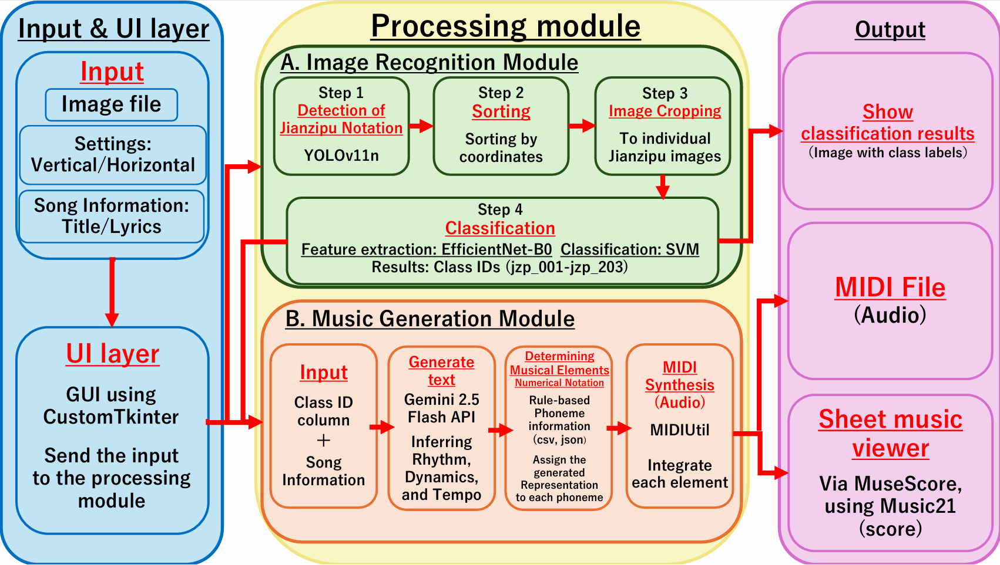
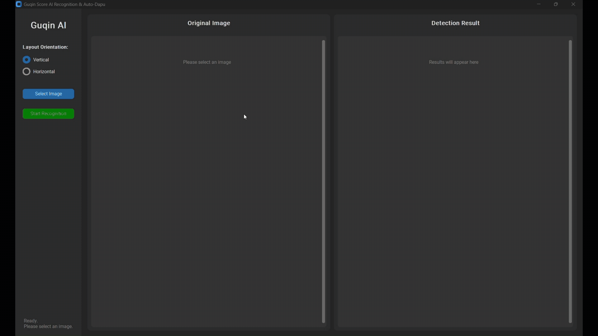
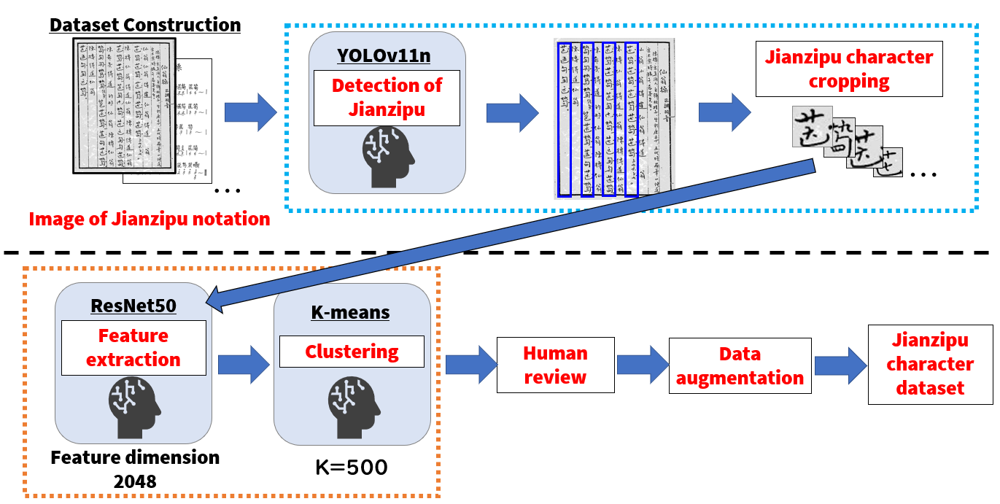

# 古琴减字谱识别与自动打谱系统 — 琴音 (Qin-Yin)

[English](README.md) | [日本語](README_ja.md) | **简体中文**


这是一个用于识别中国传统乐器古琴所使用的记谱法
**减字谱（Jianzipu）**，并生成可演奏音乐数据的端到端AI系统。

本系统从古琴谱图像中检测并识别减字谱单字，
恢复与音高相关的音乐信息，同时利用LLM补充谱面中未明确记录的演奏表现信息，
最终生成 **MIDI和现代五线谱**。

本项目基于一系列经过同行评审的研究成果。
其中，关于数据集构建与数据增强方法的研究已在
**ICMIP 2026** 发表，并以
[**"Research on Restoring Guqin Music through Deep Learning"**](https://www.spiedigitallibrary.org/conference-proceedings-of-spie/14298/3119406/Research-on-restoring-Guqin-music-through-deep-learning/10.1117/12.3119406.full)
发表于 **SPIE Digital Library**。

在此基础上进一步扩展的研究，将减字谱识别与自动打谱整合为
本仓库中实现的端到端系统，也已被在东京举行的
[**IPMV 2027**](https://ipmv.org/) 接收，并计划进行发表。

---

## 项目概述



**古琴（Guqin）** 是具有数千年历史的中国传统乐器。

其传统记谱法 **减字谱** 将指法、弦号、演奏技法等信息压缩在类似汉字结构的符号中。

但减字谱通常 **不会明确记录节奏、速度、力度等音乐表现信息**。

因此，要将减字谱恢复为可演奏的音乐，需要进行称为 **打谱（Dapu）** 的专业工作，
结合曲目背景、文本与音乐语境对缺失的表现信息进行解释。

本项目尝试通过AI辅助这一过程，集成了：

- 用于定位减字谱单字的 **目标检测**
- 用于字符识别的 **深度学习 + SVM**
- 用于恢复音高的 **规则式音乐信息映射**
- 用于生成演奏表现的 **大语言模型**
- 用于输出结果的 **MIDI / MuseScore**

### 处理流程

```text
　　　减字谱图像
　　　　　│
　　　　　▼

    减字谱单字检测 
      YOLO11n

         │
         ▼

    阅读顺序重排
    竖排 / 横排

         │
         ▼

     减字谱识别
  EfficientNet+SVM

         │
         ▼

　　音乐信息恢复
　　音高 / 技法

         │
         ▼

    AI 自动打谱
 Gemini 2.5 Flash
　　节奏 / 力度

         │
         ▼
　　MIDI / 五线谱
```

---

## 主要研究结果

本仓库基于本科毕业研究，主要实验结果如下。

| 任务 | 方法 | 结果 |
|---|---|---:|
| 减字谱单字检测 | YOLO11n | **mAP50: 99.17%** |
| 减字谱单字检测 | YOLO11n | **mAP50-95: 80.43%** |
| 减字谱单字识别 | EfficientNet-B0 + SVM | **Accuracy: 99.37%** |
| 减字谱单字识别 | EfficientNet-B0 + SVM | **Macro F1: 0.994** |
| 识别数据集 | 减字谱单字 | **203类** |
| 数据增强后 | 减字谱图像 | **40,600张** |

> 上述指标对应本科毕业论文中的实验设置。

---

## 演示



桌面GUI可以从输入的减字谱图像开始，完成单字检测、阅读顺序重排和字符识别，
并在图像中显示识别结果。

识别完成后，用户可以输入曲名以及可选的歌词或情境描述，由AI生成演奏表现参数，
并将结果导出为MIDI。

---

## 主要功能

### 减字谱单字检测

系统使用 **YOLO11n** 从完整谱面图像中检测单个减字谱符号。

研究中比较了多种YOLO架构，并综合检测精度和计算效率选择YOLO11n。

### 支持竖排与横排

- **竖排:** 从上到下、从右到左
- **横排:** 从左到右、从上到下

系统根据YOLO输出的Bounding Box坐标自动恢复阅读顺序，再进行分类。

### EfficientNet-B0 + SVM 识别

```text
减字谱单字图像
      │
      ▼
EfficientNet-B0
   特征提取器
      │
      ▼
   特征向量
      │
      ▼
     SVM
      │
      ▼
  减字谱类别
```

EfficientNet-B0负责视觉特征提取，SVM完成最终的203类分类。

### 半自动数据集构建



为降低人工整理大量减字谱图像的成本，研究采用了半自动数据集构建流程：

1. 使用YOLO检测减字谱单字
2. 裁剪单字图像
3. 使用ResNet50提取视觉特征
4. 使用k-means对相似图像进行聚类
5. 人工确认并分配类别标签
6. 使用Albumentations进行数据增强

最终构建了：

- **203个类别**
- **1,533张原始单字图像**
- **数据增强后40,600张图像**

### 音乐信息恢复

每个识别出的减字谱类别都与 `data/data.csv` 中的音乐信息关联。

其中包括：

- 弦号
- 徽位
- 演奏技法
- 发音类型
- 音高

系统结合 `data/tuning_map.json` 恢复每个减字谱符号对应的音高。

### 基于LLM的自动打谱

减字谱并未明确记录演奏所需的全部音乐信息。

系统使用 **Gemini 2.5 Flash**，输入：

- 曲名
- 可选的歌词或情境描述
- 已识别的减字谱ID序列

生成：

- 速度
- 音符时值
- 力度
- 整体音乐氛围

> LLM输出仅代表一种AI生成的解释，不应被视为经过历史验证的古琴演奏版本。

### MIDI与五线谱输出

最终音符序列可保存为标准 **MIDI文件**。

同时通过 `music21` 与 **MuseScore** 联动，可将MIDI显示为现代五线谱。

---

## 技术栈

| 类别 | 技术 |
|---|---|
| 编程语言 | Python |
| 深度学习 | PyTorch, torchvision |
| 目标检测 | Ultralytics YOLO11 |
| CNN | EfficientNet-B0 |
| 传统机器学习 | scikit-learn / SVM |
| 图像处理 | OpenCV, Pillow |
| GUI | CustomTkinter |
| LLM | Google Gemini 2.5 Flash |
| MIDI生成 | MIDIUtil |
| 音乐处理 | music21 |
| 乐谱显示 | MuseScore |

---

## 项目结构

```text
guqin-auto-dapu/
├── .gitignore
├── README.md
├── README_ja.md
├── README_zh-CN.md
├── requirements.txt
├── setup.py
├── LICENSE
├── main.py
├── detector.py
├── classifier.py
├── output_ai.py
├── utils.py
│
├── assets/
│   ├── system_architecture.png
│   ├── dataset_creation.png
│   └── demo.gif
│
├── data/
│   ├── data.csv
│   └── tuning_map.json
│
└── models/
    ├── yolo11_model.pt
    ├── efficientnet_b0_model.pth
    └── efficientnet_b0_svm_model.pkl
```

识别结果图像和生成的MIDI文件会在运行时保存到自动创建的 `output_images/` 中。
该目录已通过 `.gitignore` 排除，不纳入Git版本管理。

---

## 安装与运行

### 1. 环境要求

本项目使用Python 3.10开发，建议使用 **Python 3.10或更高版本**。

推荐使用 `venv` 或 Anaconda 等虚拟环境。

### 2. 克隆仓库

```bash
git clone https://github.com/atsu-4444/guqin-auto-dapu.git
cd guqin-auto-dapu
```

### 3. 安装依赖

```bash
pip install -r requirements.txt
```

训练好的模型文件应位于 `models/` 目录中。

> 出于安全考虑，请仅使用可信来源的模型文件。`.pkl` 以及部分 `.pt`
> 文件在加载时可能反序列化Python对象。

### 4. 配置MuseScore

如需显示五线谱，请安装 **MuseScore 4**，然后运行：

```bash
python setup.py
```

当前 `setup.py` 默认使用Windows常见安装路径：

```text
C:/Program Files/MuseScore 4/bin/MuseScore4.exe
```

如果安装在其他位置，请修改 `setup.py` 中的 `musescore_path`。

> 仅生成MIDI并不需要安装MuseScore。

### 5. 配置Gemini API

AI自动打谱功能使用 `GOOGLE_API_KEY` 环境变量。

#### Windows Command Prompt

```cmd
set GOOGLE_API_KEY=your_api_key_here
```

#### Windows PowerShell

```powershell
$env:GOOGLE_API_KEY="your_api_key_here"
```

#### macOS / Linux

```bash
export GOOGLE_API_KEY="your_api_key_here"
```

请勿将API Key直接写入源代码或提交到Git。

### 6. 启动应用

```bash
python main.py
```

应用启动时会异步加载训练好的模型。

---

## 使用方法

1. 使用 `python main.py` 启动应用
2. 选择 **Vertical / Horizontal**
3. 选择自己拥有或已获得使用许可的减字谱图像
4. 点击 **Start Recognition**
5. YOLO检测单字并恢复阅读顺序
6. EfficientNet-B0 + SVM完成字符识别
7. 在GUI中确认识别结果
8. 根据需要选择AI自动打谱
9. 输入曲名和可选的上下文信息
10. 生成并保存MIDI
11. 可选：使用MuseScore显示五线谱

---

## 数据集与第三方资料

研究主要使用了与以下琴曲相关的减字谱资料：

- **《仙翁操》**
- **《春晓吟》**

研究过程中，从公开可访问的第三方Web资料中收集谱面图像，并加工为减字谱单字样本。

**原始谱面图像和完整的研究训练数据集不会在本仓库中分发。**

如需运行本系统，请使用自己拥有或已获授权使用的减字谱图像。

`assets/` 中的研究示意图与GUI演示仅用于说明研究流程和软件行为，
并非用于分发原始研究数据集。

第三方资料的版权及其他相关权利归各自权利人所有。

---

## 安全与隐私说明

- Gemini API Key通过 `GOOGLE_API_KEY` 环境变量读取，不会硬编码在源代码中。
- 在当前实现中，用户选择的**谱面图像本身不会发送给Gemini**。
- 使用AI自动打谱时，**曲名、可选文本上下文以及识别后的减字谱ID序列**
  会发送到Gemini API。
- 请勿使用不可信来源的 `.pkl`、`.pt`、`.pth` 模型文件替换仓库内模型。
- 识别结果图像与MIDI文件保存在本地 `output_images/` 目录中。

---

## 研究背景

本仓库基于本科毕业论文：

> **《基于深度学习的古琴谱识别及自动打谱系统构建》**  
> （原题：深層学習を用いた古琴譜の識別および自動打譜システムの構築）

研究主要关注以下三个问题：

1. 扩展原本仅覆盖少量类别的减字谱识别范围
2. 使用CNN特征提取 + SVM构建高精度识别流程
3. 利用LLM的上下文理解能力补充减字谱中缺失的音乐表现信息

最终将上述处理整合为一个桌面应用程序。

---

## 我的主要贡献

本项目作为本科合作研究完成。

### Atsushi Ito — Lead Developer / Primary Technical Contributor

我主导了系统的技术设计、实现、实验与集成工作。

主要负责：

- 整体系统架构设计
- 基于YOLO的减字谱检测流程实现
- 竖排与横排阅读顺序恢复
- 减字谱识别模型开发与评估
- EfficientNet-B0特征提取与SVM分类的集成
- 减字谱到音乐信息的映射流程
- 基于Gemini的AI自动打谱方法设计与实现
- MIDI生成与MuseScore集成
- 使用CustomTkinter开发桌面GUI
- 将AI与音乐处理模块整合为端到端应用
- 主要模型对比实验与技术评估
- 面向本仓库的软件整理与维护

### Research Collaborators

**Kazuma Amano** / **Keitaro Ishii**

主要协助：

- 减字谱资料与数据收集
- 数据集检查和人工确认
- 研究过程中的审阅与确认

---

## 当前限制

本项目属于研究原型。

- 当前分类器支持 **203类减字谱**，并未覆盖完整减字谱体系。
- 数据集主要来自有限数量的古琴曲目。
- 面对不同历史写本、手写风格、印刷风格、低质量文档或未知符号时，识别性能可能下降。
- LLM自动打谱结果是一种AI生成解释，并不代表经过历史验证的演奏版本。
- MuseScore配置目前默认假设Windows常见安装路径。

---

## 后续工作

- 扩展更多琴曲和历史写本
- 提升对手写与历史文档退化的鲁棒性
- 支持未知或未登记的减字谱结构
- 探索基于偏旁/构成要素的识别
- 改进识别置信度与错误处理
- 邀请古琴专家评估生成的音乐表现
- 将LLM生成打谱与历史打谱、专家打谱进行比较
- 改进MuseScore跨平台集成

---

## Authors

### Atsushi Ito
Lead Developer / Primary Technical Contributor  
Nippon Institute of Technology  
Artificial Intelligence Laboratory

### Research Collaborators
- Kazuma Amano
- Keitaro Ishii

---

## License

This project is released under the **GNU Affero General Public License v3.0
(AGPL-3.0)**.

See [LICENSE](LICENSE) for details.

This project uses Ultralytics YOLO, which is distributed under the AGPL-3.0
license for open-source use.

Third-party Jianzipu score images and other externally sourced materials are
not covered by this license and remain subject to the rights of their
respective rights holders.
